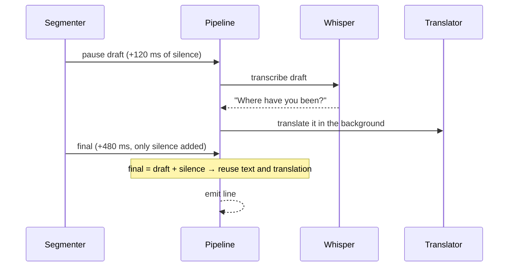

# 5. The live pipeline and latency

What you'll learn: where lag comes from in a speech → text → translation system, how to
measure it, and the scheduling tricks that hide model time.

## Concepts

**Latency budget.** Lag is a sum. Measure each part before optimizing; the biggest part is
usually not where you'd guess.

**Speculative work.** Start the expensive work *before* you know you need it (when the
speaker merely pauses). If the guess was right, the result is ready; if not, cancel it.

**Backpressure.** If new work arrives faster than you can process it, don't queue it all,
or lag grows forever. Keep only the newest draft; always process finals.

**Ordering.** Parallel work finishes out of order; the output must not.

## How Subtitler does it

`SubtitlePipeline` is an actor. Inputs from the segmenter: `submit(.partial)` /
`submit(.final)`. From Apple Speech: `submitVolatile`, `submitFinal`. Outputs:
`.draft`, `.line(original, translation, latency)`, `.detectedLanguage`, `.error`.

### Where the lag goes (M2, Whisper fast + MADLAD Q4)

| Step | Time |
|---|---|
| Notice the pause (VAD) | ~0.12 s |
| Audio arrives (100 ms chunks) | ~0.25 s |
| Whisper decode | ~0.6 s (1.0–1.2 s plain Turbo) |
| Translation | ~0.5 s per sentence |
| **Total after speech ends** | **~1.5 s** (was 3–4 s before these changes) |

### Draft reuse (the main trick)



If `final.count - draft.count <= trailingSilence`, the draft heard every word, so Whisper
and translation are both skipped for the final. A pause draft that finishes *after* the
final arrived is still recorded (the common case: decode ~0.6 s, final arrives 240–580 ms
after the pause). Drafts carry an **utterance generation**; stale ones are dropped.

### Scheduling rules

- Finals always run, in order. Only the newest draft is kept.
- One decode at a time. A pause cancels a draft that's decoding (it's stale now); a final
  cancels a regular draft but lets a pause draft finish (it'll reuse it).
- Translations of finals form a **chain**: each task awaits the previous, so lines appear
  in speech order while the next line is already being transcribed.
- `cancel()` stops everything when the session ends.

### Translate mode: finished sentences only

Burmese, Korean and Japanese put the verb last, so half a sentence can't be translated
well, and showing the original words while waiting mixes languages. So in translate mode
**no live words are shown**. The wait isn't wasted: `stableSplit` cuts what's been heard
into *complete* sentences/clauses (a clause needs a comma/semicolon and ≥3 words) and an
unfinished tail; the complete part is translated in the background. Translations are
cached **per sentence** (64 entries), so the final only translates what's new.

In transcribe mode, live words are shown and replaced in place by the finished line.

### Apple Speech specifics

Apple sometimes keeps a paragraph in one phrase. When a volatile result has a punctuated
sentence followed by more speech, that sentence is committed at once (`commitEarly`);
the final only adds what's left. Committed text is tracked by character count. When
Silero sees the speaker pause, `speakerPaused` commits without waiting for Apple's final.

### Sentence splitting

- After `. ! ?` only when followed by whitespace ("3.5" stays intact).
- Latin pieces < 4 characters join the next ("Mr. Kim").
- After `。！？` and Burmese `။` even without a space.

## Try it

```sh
say -o /tmp/test.aiff "Where have you been all night? I waited for hours. Nobody called me."
SUBTITLER_TRACE=1 app/build/Subtitler.app/Contents/MacOS/Subtitler \
  --file /tmp/test.aiff --source en --target my --realtime
```

Look for `reused draft` in the trace and the `lag` printed per line. Mix in background
noise (e.g. with `ffmpeg -filter_complex amix`) and compare.

## Code map

- `app/Sources/Subtitler/SubtitlePipeline.swift`: everything above; `Trace` for `SUBTITLER_TRACE`
- Tests: `SubtitlePipelineTests` (reuse, order, cancel, stableSplit, early commit)

## Further reading

- "Turning Whisper into Real-Time Transcription System" (LocalAgreement): https://arxiv.org/abs/2307.14743
