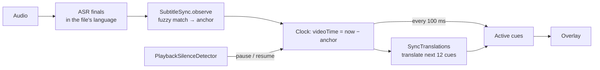

# 9. Subtitle sync

What you'll learn: how to align a known text (a subtitle file) with a live audio stream
using noisy speech recognition, and why this beats live translation for films.

## Concepts

**Live translation is always late.** You can't translate a sentence before it ends: speech
end → decode → translate is ≥ 1.5 s. A subtitle file already knows every line *and its
time*. If we know where the video is in the file, we can show each line exactly on time,
already translated.

**So the problem becomes alignment**: "the recognizer just heard X; where in the file is
X?" The recognizer is noisy (wrong words, missed words) and the file's wording differs a
little from what's said, so exact matching fails. We need **fuzzy text similarity**.

**Character bigrams + Dice coefficient.** Break text into overlapping pairs of characters:
"hello" → `he el ll lo`. Dice similarity = 2 × shared pairs ÷ total pairs, 0–1. It's
robust to single wrong letters and word boundaries, and works for languages without spaces
(Korean, Chinese, Japanese). No model needed.

**A clock from an anchor.** Once matched, store `anchor` = the wall-clock time when the
video was at 0:00. Then `videoTime = now − anchor`, and the line to show is the cue whose
`start ≤ videoTime < end`.

**Robust estimation.** Accept a strong single match; otherwise require two independent
matches that agree. This keeps one coincidental match ("Yes." appears 40 times) from
moving the clock.

## How Subtitler does it



1. **Normalize**: lowercase, keep only letters and digits (drops punctuation, tags, spaces).
2. **Match** each heard line (≥ 6 chars) against runs of **1–4 consecutive cues** (one
   spoken sentence may span several cues). Once synced, search ±45 s around the expected
   position first; if nothing fits, search the whole file.
3. **Adopt a position**: score ≥ 0.8 with ≥ 20 characters syncs at once; ≥ 0.55 needs a
   second match agreeing within 1.5 s.
4. **Anchor on the end of speech**: `anchor = speechEndedAt − cue.end` (subtitles end
   roughly when the words do).
5. **Drift**: a later match agreeing with the clock nudges the anchor 30% towards it.
6. **Seeks / ad breaks / next episode**: a match elsewhere is held as `pendingAnchor`; a
   second agreeing one moves the clock.
7. **Pause**: players output *exact* digital silence when paused (a quiet scene never is).
   `PlaybackSilenceDetector` sees 0.6 s of zeros → the clock freezes; when sound returns
   the anchor shifts by the paused time.
8. **Translate ahead**: `SyncTranslations` translates the next 12 cues in the background
   as the clock moves (the lines at a new position first after a jump). If `Movie.my.srt`
   exists next to `Movie.en.srt` with the same cues, it's used and nothing is translated
   live. A line whose translation isn't ready isn't shown in the original language.
9. **File language** is detected with Apple's NaturalLanguage (`NLLanguageRecognizer`) from
   the first 200 cues, and the recognizer listens in that language.

**Limit:** the file must be in the *spoken* language (Korean subtitles for a Korean drama)
for text matching. Aligning a file in another language would need timing-only alignment
(speech activity vs cue times), which isn't implemented.

## Try it

`SubtitleSyncTests` simulate a video: they feed heard lines at wall-clock times and check
the clock, seeks, pauses and drift. Run them:

```sh
cd app && swift test --filter SubtitleSync
```

## Code map

- `app/Sources/Subtitler/Sync/SubtitleSync.swift`: matching, anchor, pause detector
- `app/Sources/Subtitler/Sync/SyncTranslations.swift`: look-ahead translation, reuse, language detect
- `AppState.swift`: `startSync`, `updateSyncedCaptions` (100 ms tick)

## Further reading

- Sørensen–Dice coefficient: https://en.wikipedia.org/wiki/S%C3%B8rensen%E2%80%93Dice_coefficient
- Forced alignment (the heavier, audio-level version of this problem): https://en.wikipedia.org/wiki/Forced_alignment
