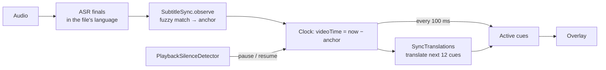

# 9. Subtitle sync

What you'll learn: how to align a known text (a subtitle file) with a live audio stream
using noisy speech recognition, and why this beats live translation for films.

## Concepts

**Live translation is always late.** You can't translate a sentence before it ends: speech
end → decode → translate is ≥ 1.5 s. A subtitle file already knows every line *and its
time*. If we know where the video is in the file, we can show each line exactly on time,
already translated.

**So the problem becomes alignment**: "the recognizer just heard X; where in the file is
X?" The recognizer is noisy (wrong words, missed words) and the file's wording differs a
little from what's said, so exact matching fails. We need **fuzzy text similarity**.

**Character bigrams + Dice coefficient.** Break text into overlapping pairs of characters:
"hello" → `he el ll lo`. Dice similarity = 2 × shared pairs ÷ total pairs, 0–1. It's
robust to single wrong letters and word boundaries, and works for languages without spaces
(Korean, Chinese, Japanese). No model needed.

**A clock from an anchor.** Once matched, store `anchor` = the wall-clock time when the
video was at 0:00. Then `videoTime = now − anchor`, and the line to show is the cue whose
`start ≤ videoTime < end`.

**Robust estimation.** Accept a strong single match; otherwise require two independent
matches that agree. This keeps one coincidental match ("Yes." appears 40 times) from
moving the clock.

## How Subtitler does it



1. **Normalize**: lowercase, keep only letters and digits (drops punctuation, tags, spaces).
2. **Match** each heard line (≥ 6 chars) against runs of **1–4 consecutive cues** (one
   spoken sentence may span several cues). Once synced, search ±45 s around the expected
   position first; if nothing fits, search the whole file.
3. **Adopt a position**: score ≥ 0.8 with ≥ 20 characters syncs at once; ≥ 0.55 needs a
   second match agreeing within 1.5 s.
4. **Anchor on the start of speech**: `anchor = speechStart − firstCue.start − bias`
   (cue starts track the first word; ends are padded). See the measurements below.
5. **Drift**: a later match agreeing with the clock nudges the anchor 30% towards it.
6. **Seeks / ad breaks / next episode**: a match elsewhere is held as `pendingAnchor`; a
   second agreeing one moves the clock.
7. **Pause**: players output *exact* digital silence when paused (a quiet scene never is).
   `PlaybackSilenceDetector` sees 0.6 s of zeros → the clock freezes; when sound returns
   the anchor shifts by the paused time.
8. **Translate ahead**: `SyncTranslations` translates the next 12 cues in the background
   as the clock moves (the lines at a new position first after a jump). If `Movie.my.srt`
   exists next to `Movie.en.srt` with the same cues, it's used and nothing is translated
   live. A line whose translation isn't ready isn't shown in the original language.
   Between cues (`SubtitleSync.shownCues`), a gap of up to 2 s keeps the last line up until
   the next starts, and after a longer gap it stays 1 s more: cues often end a beat before
   the next begins, and showing only exact cue times made captions blink off and on at
   every pause.
9. **Whole sentences** (`SubtitleSentences`): files often split one sentence over cues
   ("I told you" / "not to go there."). Translated separately, each half becomes a
   sentence of its own, and in verb-final Burmese the halves can't be glued back. So
   consecutive cues are joined while the first doesn't end a sentence (no `. ! ? 。`, or
   an ellipsis followed by "…" or a lowercase word), the gap is ≤ 1.5 s, neither is
   dialogue (`- `), and at most 3 cues. The group is translated once and shown for all
   its cues. Files with almost no sentence punctuation (common in Korean) aren't joined.
10. **Timing offset**: a −2…+2 s control in the panel nudges the clock live, for files
    whose cue ends are padded or players with audio delay.
11. **File language** is detected with Apple's NaturalLanguage (`NLLanguageRecognizer`) from
   the first 200 cues, and the recognizer listens in that language.

**Limit:** the file must be in the *spoken* language (Korean subtitles for a Korean drama)
for text matching. Aligning a file in another language would need timing-only alignment
(speech activity vs cue times), which isn't implemented.

### Measured accuracy, and why the clock anchors on the start of speech

`--file clip --realtime --sync clip.srt` plays audio with known cue times and prints, for
every matched line, the clock error each end of it implies (+ = subtitles late).

**A clean TTS clip** (8 lines, cue times = the exact speech times) looked perfect: +0.02 s.
It hid the real problem, because nothing about it is like a film.

**A real film:** *Tears of Steel* (Blender, CC-BY): the official stereo mix (dialogue over
music and effects) and its English SRT, 12 minutes, M2. Median error per matched line,
outliers over 5 s (wrong-position matches) excluded:

| Engine | Anchor | Lines | Median | Middle 50% |
|---|---|---|---|---|
| Whisper (Silero segmenter) | speech **start** vs cue start | 25 | +0.39 s | +0.19 … +0.60 |
| Whisper | speech end vs cue end | 32 | −0.17 s | −0.37 … +0.13 (single lines ±1.5 s) |
| Apple Speech | start | 64 | −0.84 s | −1.07 … −0.44 |
| Apple Speech | end | 71 | −0.17 s | −0.67 … +0.06 |

What the numbers say:

- **Cue ends are unreliable.** Subtitlers pad ends for reading time, or trim them when the
  next line follows; the end-based error swings by more than a second between lines.
- **Cue starts are consistent, with a lead-in.** On the clean clip the segmenter finds
  speech onsets within 0.02 s, so the +0.39 s on the film is the file: its cues start about
  0.4 s before the words, a common subtitling habit. Taking that constant out makes the
  clock follow the file's own timing, as a video player would show it.
- **Apple Speech's phrase ranges start early**, with some of the silence before the words.
- **The "0.8 s late" people saw with Apple Speech** was a bug, not the anchor: lines were
  finished early at a Silero pause, and that path stamped the line with the time the code
  ran rather than when the speech ended. In Subtitle file mode lag doesn't matter, so the
  pipeline now uses only Apple's final results there, each with its exact audio range.

So the clock anchors on `speech start − first cue start`, minus the measured bias for the
engine that heard the line (`SubtitleSync.Bias`: +0.39 s segmenter, −0.84 s Apple). The
start only counts when the heard line begins with the cue's first words (compared on the
first dozen characters) and began at a real onset; otherwise it falls back to the end.
The Timing control still nudges the result for files timed differently.

Limits of this measurement: one film, one subtitle file. The dialogue stem (stereo mix
minus the music-and-effects mix) didn't cancel cleanly (the two were mixed differently), so
how late the segmenter notices the *end* of speech under music couldn't be separated from
the cue padding.

The first TTS run showed the clock drifting 0.15 s later per line. That was the harness,
not the sync: sleeping 100 ms per chunk runs slower than real time. It now paces on an
absolute schedule. A good lesson: check the measuring tool before trusting the measurement.

## Try it

`SubtitleSyncTests` simulate a video: they feed heard lines at wall-clock times and check
the clock, seeks, pauses and drift. Run them:

```sh
cd app && swift test --filter SubtitleSync
```

## Code map

- `app/Sources/Subtitler/Sync/SubtitleSync.swift`: matching, anchor, pause detector
- `app/Sources/Subtitler/Sync/SyncTranslations.swift`: look-ahead translation, reuse, language detect
- `AppState.swift`: `startSync`, `updateSyncedCaptions` (100 ms tick)

## Further reading

- Sørensen–Dice coefficient: https://en.wikipedia.org/wiki/S%C3%B8rensen%E2%80%93Dice_coefficient
- Forced alignment (the heavier, audio-level version of this problem): https://en.wikipedia.org/wiki/Forced_alignment
