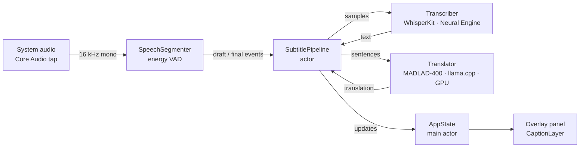
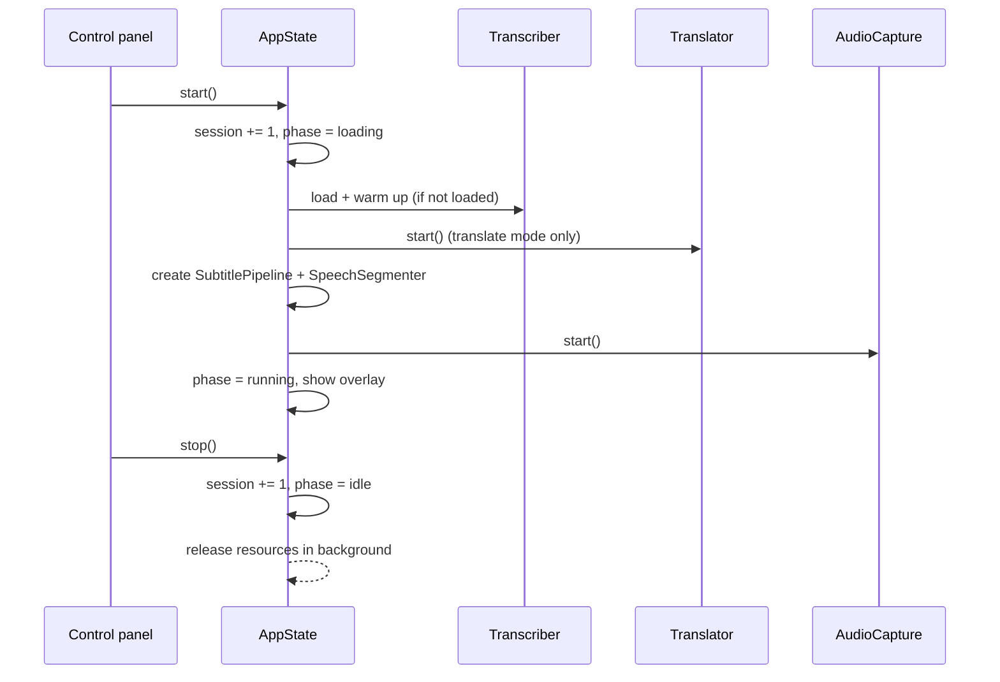
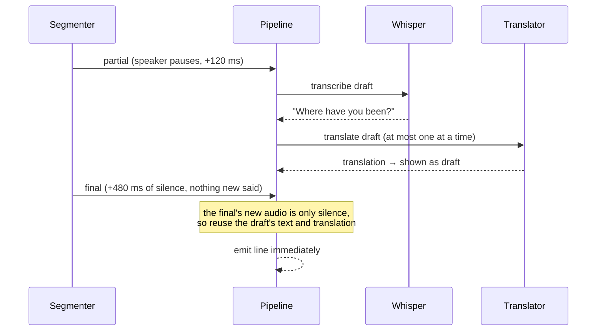

# How Subtitler works

This document explains how the app is put together, from the sound your Mac plays to
the caption on screen. It is written for anyone working on the code. For setup and usage,
see the [README](../README.md).

- [1. The big picture](#1-the-big-picture)
- [2. Repository layout](#2-repository-layout)
- [3. App shell: launch, windows, onboarding](#3-app-shell-launch-windows-onboarding)
- [4. A live session](#4-a-live-session)
- [5. Audio capture](#5-audio-capture)
- [6. Speech segmentation (VAD)](#6-speech-segmentation-vad)
- [7. Speech recognition](#7-speech-recognition)
- [8. The subtitle pipeline](#8-the-subtitle-pipeline)
- [9. Translation](#9-translation)
- [10. Captions and the overlay](#10-captions-and-the-overlay)
- [11. Models: catalog, download, delete](#11-models-catalog-download-delete)
- [12. Settings and persistence](#12-settings-and-persistence)
- [13. Developer modes](#13-developer-modes)
- [14. Build and packaging](#14-build-and-packaging)
- [15. Tests](#15-tests)
- [16. Known limitations](#16-known-limitations)

---

## 1. The big picture

Subtitler is a native macOS menu bar app for Apple Silicon. It runs everything on the Mac:



| Stage | Technology | Where it runs |
|---|---|---|
| Audio capture | Core Audio process tap (macOS 14.2+), ScreenCaptureKit fallback | Audio thread |
| Segmentation | Energy-based voice activity detection (VAD) | Capture queue |
| Speech to text | Apple Speech (`SpeechAnalyzer`, macOS 26) or [WhisperKit](https://github.com/argmaxinc/WhisperKit) (CoreML Whisper) | On-device / Neural Engine |
| Translation | MADLAD-400 3B GGUF on [llama.cpp](https://github.com/ggml-org/llama.cpp) | GPU (Metal) |
| UI | SwiftUI + AppKit (`NSPanel`) | Main thread |

The app ships with **no models**. People download them in the app (section 11).

Two properties shape most of the design:

1. **Low latency.** Captions should appear within about a second of the speaker pausing.
   The main trick is described in section 8: the work for a line is usually already done
   by the time the line ends.
2. **8 GB Macs are the floor.** Models are quantised, loaded once per session, and heavy
   work is serialised rather than run in parallel.

---

## 2. Repository layout

```
app/                          Swift package (the Mac app)
  Package.swift               WhisperKit, llama.cpp (binary xcframework), test target
  Resources/                  Info.plist, AppIcon.icns
  Sources/Subtitler/
    SubtitlerApp.swift        Entry point, scenes, WindowRouter, AppDelegate
    AppState.swift            Session lifecycle and everything the UI shows
    SubtitlePipeline.swift    Drafts, finals, translation ordering, latency tricks
    FileRunner.swift          Headless --file and --audio-probe modes
    Snapshotter.swift         --snapshot: renders windows to PNG
    Audio/                    Capture (tap + ScreenCaptureKit), segmenter, permission
    ASR/Transcriber.swift     WhisperKit wrapper
    Translation/              Translator protocol, llama.cpp, Python sidecar, languages
    Models/                   Catalog, on-disk files, ModelStore (UI state)
    Overlay/                  NSPanel, CaptionLayer, CaptionStyle, sample captions
    UI/                       Control panel, Captions, Models, Welcome windows
  Tests/SubtitlerTests/       Swift Testing unit + integration tests
python/                       Evaluation script and the developer translation sidecar
scripts/                      build-app.sh, make-icon.swift
docs/                         This document
```

The app is a plain Swift package with no Xcode project, so it builds with only the
Command Line Tools. Two consequences:

- The SwiftUI `@State` macro plugin ships only with Xcode, so views keep local state in
  small `ObservableObject`s held by `@StateObject` (see `WelcomeView.Flow`).
- `scripts/build-app.sh` assembles the `.app` bundle by hand (section 14).

---

## 3. App shell: launch, windows, onboarding

`Entry.main()` (`SubtitlerApp.swift`) chooses a mode from the command line: `--snapshot`,
`--audio-probe` and `--file` run headless (section 13); otherwise it starts the SwiftUI
app. It also ignores `SIGPIPE`, so writing to a crashed sidecar returns an error instead
of killing the app.

`SubtitlerApp` creates three long-lived objects and shares them with every window:

| Object | Role |
|---|---|
| `ModelStore` | What is installed, downloading and selected |
| `CaptionStyle` | How captions look; persisted |
| `AppState` | The live session and the text on screen |

Scenes:

| Scene | Content |
|---|---|
| `MenuBarExtra` | The control panel, from the captions icon |
| `Window("main")` | The same control panel as a normal window |
| `Window("welcome")` | First-run setup |
| `Window("captions")` | Caption styling with live preview |
| `Window("models")` | The model library |

A menu bar icon alone is easy to miss, especially behind the notch, so the app shows a
window when it launches and when it is reopened. SwiftUI only provides `openWindow` inside
views, so the menu bar label registers it with `WindowRouter` in its `.task`, which runs at
launch. `WindowRouter.showAtLaunch` opens the welcome window on first run, otherwise the
main window, and does so once. `AppDelegate.applicationShouldHandleReopen` routes later
reopens (Spotlight, Finder, `open`) to the main window.

### Onboarding

`WelcomeView` walks through five steps: welcome, speech model, translation model (with
the subtitle language), permission, done. People can continue while a download is still
running. "Skip — transcribe only" switches the mode instead of choosing a translator. The
permission step is skipped when the permission is already granted, and it polls the status
every second so a change made in System Settings shows up immediately.

---

## 4. A live session

`AppState` owns the session. Its `phase` is `.idle`, `.loading(message)`, `.running` or
`.failed(message)`.



### Session IDs

Every `start()`, `stop()` and failure increments `session`. Asynchronous work carries the ID
it was started with:

- `run(id)` calls `checkSession(id)` after each `await` and aborts if the ID changed. This
  is how Cancel works while a model is still loading.
- Pipeline updates are delivered as `apply(update, session: id)` and dropped if stale.
- Capture failures are ignored unless they belong to the current session.

Without this, pressing Stop and then Start quickly could let the old session's cleanup tear
down the new one.

### Resources

A running session's objects (pipeline, capture, translator, event pump) are held together
in `AppState.Resources`. `endSession()` takes them out of `AppState` *before* any `await` and
releases them in a background task. A new session can start at once and is never touched
by the old one's cleanup.

### Per-session settings

When a session starts, `run` snapshots the mode and target language. The mode and language
pickers are disabled while it runs, and the overlay uses the snapshot, so switching the UI
mid-session cannot change the font or language of live captions. Caption *style* changes
apply live.

While a session is loading or running, `ModelStore.inUse` holds the IDs of the loaded
models. Those models cannot be deleted, and no model can be swapped, until the session ends.

---

## 5. Audio capture

`AudioCapture` is a small protocol: `start()`, `stop()`, an `onSamples` callback delivering
**16 kHz mono Float32**, and `onStop` for failures. `AudioCaptureFactory.make()` picks the
implementation.

### Core Audio process tap (macOS 14.2+)

`CoreAudioTapCapture`:

1. Creates a `CATapDescription` for a **mono global tap** that excludes Subtitler's own
   process, so nothing the app plays is captured.
2. Reads the tap's stream format (usually 48 kHz Float32).
3. Creates a **private aggregate device** with the default output device as its main
   sub-device and the tap in its tap list.
4. Starts an IO proc on the aggregate device. Each callback takes the *last* buffer in the
   buffer list, which is the tap. Devices with their own inputs, such as USB interfaces,
   put those streams first. The callback copies the audio into a buffer it owns and
   resamples it to 16 kHz with `AVAudioConverter`.
5. Listens for changes to the default output device, for example when AirPods connect, and
   rebuilds the tap on the new device.

Core Audio objects are created and destroyed on a *control* queue; IO callbacks run on a
separate *IO* queue. Stopping the device on the queue that delivers its callbacks could
deadlock. If `start()` fails partway, everything created so far is destroyed.

This path needs only the **System Audio Recording** permission (`NSAudioCaptureUsageDescription`).
It never sees the screen.

### ScreenCaptureKit fallback (macOS 14.0–14.1)

`SystemAudioCapture` uses an `SCStream` with audio enabled and a 2×2 px, 1 fps video
stream, which the API requires and the app ignores. It needs the Screen Recording permission.

### Permission status

macOS has no public API to check or request System Audio Recording. `AudioPermission`
loads `TCCAccessPreflight` / `TCCAccessRequest` from the TCC framework with `dlsym` when
they exist and reports `.unknown` otherwise. On the ScreenCaptureKit path it uses
`CGPreflightScreenCaptureAccess`.

---

## 6. Speech segmentation (VAD)

`SpeechSegmenter` turns the continuous stream into **utterances** and emits two kinds of
event:

- `.partial(samples, isPause:)` is the utterance so far, used for drafts. `isPause` marks
  the draft sent the moment the speaker pauses.
- `.final(samples, trailingSilence:)` is the finished utterance, plus how many samples of
  silence it ends with.

### Algorithm

Audio is cut into 30 ms frames (480 samples). For each frame:

1. **Energy** is the mean of the squared samples.
2. **Speech** means energy > max(6 × noise floor, 2·10⁻⁵).
3. While idle, the noise floor tracks the background slowly (2% per frame), and the last
   300 ms of frames are kept as a pre-roll.
4. At speech onset the utterance starts with the pre-roll, so the first syllable isn't
   clipped, and then the onset frame.
5. During the utterance:
   - **After 120 ms of silence**, emit a *pause draft* of everything said so far.
   - **After `endSilence` of silence**, emit the final, if there were at least 240 ms of
     speech. Shorter blips are dropped.
   - **At `maxSeconds`**, cut at the quietest frame of the last 3 s rather than mid-word,
     and carry the rest into the next utterance. The final's `trailingSilence` is 0.
   - **Every `draftEvery` of new audio**, emit a regular draft.
6. **Music and ambience:** speech has short dips between words, and steady music doesn't.
   If the quietest frame in the last 3 s is still above the speech threshold, the noise
   floor rises towards it. A constant music bed then stops counting as speech, and the
   utterance can end.

### Responsiveness presets

| Preset | `endSilence` | `draftEvery` | `maxSeconds` |
|---|---|---|---|
| Fast | 360 ms | 500 ms | 6 s |
| Balanced (default) | 480 ms | 700 ms | 9 s |
| Accurate | 700 ms | 1000 ms | 14 s |

Shorter settings show lines sooner but split sentences more often. Longer settings give
Whisper whole sentences, which it transcribes better.

The segmenter is not thread-safe. It is only called from the capture queue, and its events
go into an `AsyncStream` that one task forwards to the pipeline in order.

---

## 7. Speech recognition

There are two engines. The session picks one in `AppState.chooseSpeechEngine()`:

- **Apple Speech** is used when it is selected, macOS is 26 or later, and the spoken
  language is set (not Auto-detect) to one Apple supports: English, Korean, Japanese,
  Chinese, French, German, Spanish or Portuguese.
- **Whisper** is used otherwise. When Apple Speech is selected but can't be used, the
  recommended installed Whisper model takes over, and the panel says why.
- **Auto-detect with Apple Speech** (on by default, `appleAutoHandover`): the session
  starts on Whisper, and when the first final line reveals the language, it switches to
  Apple Speech if Apple supports that language. Captured audio goes through a
  `SampleRouter`, so the session can re-point it from Whisper's segmenter to the Apple
  recognizer without restarting capture. Work Whisper already queued still finishes.

### Apple Speech (streaming)

`AppleSpeechRecognizer` feeds captured audio, converted to the analyzer's preferred
format, into a `SpeechAnalyzer` with a `SpeechTranscriber` (`.progressiveTranscription`
preset). There is no segmenter and no Whisper. Apple does its own endpointing and reports:

- **volatile results**: the words so far, updated about once a second, usually within
  0.1–0.5 s of being spoken. These go to `SubtitlePipeline.submitVolatile`.
- **final results**: one per phrase, about 1 s after it ends. These go to `submitFinal`,
  with the phrase end estimated from `result.range.end` against the audio fed so far.

The language's on-device assets are installed through `AssetInventory` the first time;
the status line shows the download. Apple Speech is listed in the catalog as a built-in
model (`Source.system`): always installed, nothing to download or delete.

### Whisper (WhisperKit)

`Transcriber` is an actor around `WhisperKit`. It conforms to `SpeechTranscribing`, the
protocol the pipeline depends on, so tests can use a fake.

- **Loading.** `load(model:folder:)` loads a downloaded CoreML model folder, with no
  network access, and prewarms it. The first load on a Mac compiles the model for the
  Neural Engine and can take minutes; CoreML caches the result.
- **Warm-up.** `warmUp()` decodes one second of near-silence, so the first real line doesn't
  pay for GPU and Neural Engine setup.
- **Decoding options.** Transcribe task, temperature 0, no timestamps, blank suppression,
  no-speech threshold 0.6. With a known language the language token is prefilled;
  otherwise Whisper detects it.
- **Hallucination filter.** Whisper's stock outputs for silence and music ("Thank you for
  watching.", "[Music]", "♪" and similar) are dropped.

`Transcriber.recommendedModel` asks WhisperKit which model suits the current chip. The
catalog marks that model as Recommended.

---

## 8. The subtitle pipeline

`SubtitlePipeline` is an actor that turns segmenter events into UI updates:

| Update | Meaning |
|---|---|
| `.draft(DraftCaption?)` | In-progress text, translated or source; `nil` clears it |
| `.line(original:translation:latency:)` | A finished caption line |
| `.detectedLanguage(code)` | Auto-detection settled |
| `.error(message)` | Something failed; shown in the panel |

### Scheduling

- **Finals always run, in order.** Drafts run only when no final is waiting, and only the
  newest draft is kept. On a slow Mac this means fewer drafts, not growing lag.
- **Speech recognition is serial:** one `drain()` loop feeds the transcriber, and
  `Transcriber` itself queues calls, so WhisperKit never runs two decodes at once.
- **Pause drafts win.** When the speaker pauses, any draft still decoding is cancelled,
  because a new pause means it is stale. A final cancels a regular draft but lets a pause
  draft finish, because the final will reuse it. Whisper's encoder can't be interrupted
  midway, so a cancel saves the decoder time, not the whole decode.
- **Translation of finals is a chain of tasks.** Each task waits for the previous one, so
  lines always appear in speech order even when translations finish out of order. While
  one line is being translated, the next line is already being transcribed.

### Why lines appear quickly

Work for a line usually starts well before the line ends:



A pause draft that finishes *after* the final arrived is still recorded (it just isn't
shown); this is the common case, because the final comes 240–580 ms after the pause and a
decode takes about a second.

In `finalize`, if the final contains no new audio beyond the last draft except its trailing
silence (`final.count - draft.count <= trailingSilence`), the draft already heard every
word. The pipeline then skips both Whisper and translation:

1. If the draft's translation has finished (`translatedDraft`), use it.
2. If it is still running (`draftTranslation`), wait for it.
3. Otherwise, translate normally.

Drafts are tagged with an **utterance generation**. A draft or draft translation that
finishes after its utterance has ended is dropped.

**Latency** is measured from the moment the segmenter emits the final to the moment the
line is emitted. `AppState` smooths it and shows it in the status line.

### Language detection

In auto mode, the first language comes from the **first final**, never from a draft: half
a second of audio is too little to trust.

Auto-detect keeps listening after that, so switching to a video in another language
needs no restart:

- Whisper decodes without a language hint, and every result with at least 1.5 s of audio
  reports the language it heard. Two results in a row agreeing on a new language switch
  the session to it (`observeLanguage`); a single foreign line or song doesn't.
- While Apple Speech transcribes, Whisper's segmenter keeps running on the same audio (the
  `SampleRouter` fans it out) and `detectLanguage` samples the language at most every
  3 s, without transcribing.
- On a change, `AppState.followLanguage` restarts Apple Speech in the new language if Apple
  supports it, or hands transcription back to Whisper if not. The session keeps running.

### Translate mode shows finished lines only

Languages put words in different orders (Burmese, Korean and Japanese put the verb
last), so a sentence can't be translated well before it ends, and showing the original
words meanwhile mixes two languages on screen. In translate mode the pipeline therefore
emits no live words at all (`emit` drops drafts when there is a target): each line
appears once it is finished.

The waiting time is still used. `stableSplit` cuts the words heard so far into a
*complete* part (sentences, and clauses ending in a comma or semicolon once they have
three or more words) and the unfinished *tail*, and the complete part is translated in the
background. By the time the line ends, its translation is usually done or nearly done.
When a line finishes, a background translation of text the line doesn't start with is
cancelled so the line never waits behind it.

### Unclear lines and context

Translation can't fix misheard words, so two things reduce them:

- **Hide lines that were hard to hear** (on by default). Whisper's confidence is the
  average token probability, exp(mean log-probability); Apple Speech's is the average of
  its per-word `transcriptionConfidence`. Lines below 0.6 (Whisper) or 0.5 (Apple), and
  Whisper output that repeats itself (compression ratio above 2.4), are dropped rather
  than shown and translated; the panel counts them. On an M2, clear speech scored
  0.92–0.98 with Whisper, while speech buried in noise came back as unrelated words at
  0.56. The filter can't catch a *confident* mishearing: Apple heard 받았어 as 맞았어 at 0.93.
- **Context prompt.** The last two finished lines are passed to Whisper as its prompt
  (`promptTokens`, at most 100 tokens) so names and terms are heard consistently. It is
  left out while a change of language may be under way, because a prompt pulls Whisper
  towards the language it's written in.

### Streaming recognizers

Apple Speech bypasses the segmenter path. `submitVolatile` shows the words and translates
them, keeping at most one draft translation in flight. `submitFinal` commits the phrase
through the same `commit()` as Whisper finals, reusing the draft translation when the text
matches.

Apple Speech sometimes keeps a whole paragraph in one phrase. Once a volatile result
contains a sentence followed by more speech, that sentence is shown as a finished line
right away, and the eventual final only adds the sentences not shown yet.

Translations are also cached **per sentence** (64 entries). A volatile result often
already contains the finished first sentences of a phrase, so the final only translates
what is new.

### Transcribe-only

With `target == nil` nothing is translated. Lines are emitted as spoken, and nothing is
split or re-joined, so CJK and Burmese punctuation is untouched.

### Cancellation

`cancel()` sets a flag, clears queued segments, cancels in-flight translations and blocks
every later emit. `AppState` calls it when a session ends.

### Sentence splitting

`SubtitlePipeline.translate` translates one sentence at a time. Short inputs are faster,
and machine translation models loop or drop clauses on long run-on transcripts. Rules:

- Split after `. ! ?` only when followed by whitespace, so "3.5" stays intact.
- Latin pieces shorter than 4 characters join the next sentence ("Mr. Kim…").
- Split after `。！？` and the Burmese `။` even without a space.

---

## 9. Translation

```swift
protocol Translator: Sendable {
    func start() async throws
    func translate(_ text: String, from: String, to: String, context: [String]) async throws -> String
    func stop() async
}
```

`context` carries the previous four source lines, for engines that can use them to keep
names and pronouns consistent. The current MADLAD engine translates sentence by sentence
and does not use it yet.

`TranslatorFactory.make(selection:)` maps the stored selection to an engine:

| Selection | Engine |
|---|---|
| A catalog model ID | `LlamaTranslator` with that GGUF file |
| `sidecar:nllb`, `sidecar:madlad`, `sidecar:echo` | `SidecarTranslator` (`--dev` builds only) |
| `off` | `PassthroughTranslator` (tests and `--file`) |

If a translator fails to start, the session falls back to the original text and shows why.

### LlamaTranslator (MADLAD-400 on llama.cpp)

MADLAD-400 is an encoder–decoder (T5) model. It picks the output language from a `<2xx>`
prefix and detects the source language itself, so one loaded model serves every language
pair.

For each sentence:

1. Clear the KV memory and reset the sampler.
2. Tokenize `<2{target}> {text}`, capped at 480 tokens, and run the **encoder** once with
   `llama_encode`. The context uses `n_batch = n_ubatch = 512`, because the encoder must see
   the whole input in one batch.
3. Decode from the model's decoder start token with a sampler chain: a repetition penalty
   (last 64 tokens, ×1.15), then greedy.
4. Stop at end of generation, or at min(256, 4 × input tokens + 16) tokens: Burmese needs
   roughly 2–3× the source tokens, and more means a loop. Also stop if the last 8 tokens
   repeat the 8 before them.
5. Detokenize the output.

All layers are offloaded to the GPU. `start()` runs one throwaway translation, so the
Metal kernels compile before the first real line. llama.cpp's logs are silenced except
for errors.

### SidecarTranslator (developer engine)

This engine talks to `python/translate_server.py` over stdin and stdout, one JSON object
per line:

```
← {"ready": true, "engine": "nllb"}
→ {"id": 1, "text": "Hello", "source": "en", "target": "my", "context": []}
← {"id": 1, "translation": "မင်္ဂလာပါ"}      or  {"id": 1, "error": "..."}
```

- One ordered `AsyncStream` reads stdout, and pending requests are continuations keyed by ID.
- If the process exits, every pending request fails.
- The ready handshake times out after 5 minutes.

The sidecar exists to compare engines such as NLLB-200 (CC-BY-NC, so never in a release)
against MADLAD. The app finds it through the `SubtitlerRepoRoot` key that
`build-app.sh --dev` writes into Info.plist, the `SUBTITLER_REPO` environment variable, or
by walking up from the working directory.

### Languages

`Languages.swift` lists 45 languages: Burmese and the main film languages (English, Korean,
Japanese, Chinese) first, then the rest by name. Codes are Whisper's ISO 639-1 codes, which
MADLAD-400 uses as its `<2xx>` target tags too. `python/translators.py` covers 16 of them
for the NLLB sidecar; a Python test checks that each is also in the Swift list. Apple
Speech hears 9 of them (EN, KO, JA, ZH, FR, DE, ES, IT, PT); Apple Translation, which isn't
used yet, lacks Burmese and Malay.

---

## 10. Captions and the overlay

### The overlay window

`OverlayPanel` is a borderless, non-activating `NSPanel`:

- `level = .screenSaver`, above everything, including full-screen video
- `ignoresMouseEvents = true`, so clicks pass through
- `collectionBehavior = [.canJoinAllSpaces, .fullScreenAuxiliary, .stationary, .ignoresCycle]`
- It never becomes key or main

`OverlayController` sizes the panel to the **screen with the mouse pointer**, minus the
notch (`safeAreaInsets.top`). It re-picks the screen when displays change, when the Space
changes (for example into a full-screen player) and when another app comes to the front.
The panel covers the whole screen, so moving captions or changing their width only
re-lays out SwiftUI; the window stays where it is.

### CaptionLayer: one view for the overlay and the preview

`CaptionSlot.slots(...)` decides what is on screen: `lineCount` boxes in total, counting
the line being spoken. The bottom box always has the same identity (`currentID`). While
someone speaks it shows the live words; when the line is finished, the finished line takes
the same box. The text updates in place instead of a new box appearing below. With the
default `lineCount` of 1, only that one line is shown.

- A finished line shows the translation and, optionally, the original in a smaller font.
- Live words use exactly the finished line's style (font, size, weight, colour, spacing),
  so every caption setting applies to both and nothing jumps when the line is finished.

It positions everything at the top or bottom, at `offset × height` from the edge, at most
`maxWidth × width` wide.

The live overlay (`SubtitleOverlayView`) and the preview in the Captions window use this
same view, with the same `CaptionStyle` object. The preview passes
`scale = previewWidth / screenWidth`, so it keeps the real proportions. Every setting
change redraws both at once.

Sample captions (`SampleCaptions.swift`) contain four lines in every subtitle language, so
the preview shows the real script: stacked Burmese, CJK, Arabic. "Preview on screen" puts
them on the actual overlay.

### CaptionStyle

`CaptionStyle` holds all the appearance settings (font, weight, size, line spacing, text
colour, edge, background colour and opacity, corner radius, position, offset, max width,
line count, show original, original size, show drafts, clear-after). Each is saved to
UserDefaults on change.

- **Font "Automatic"** means Noto Sans Myanmar for Burmese and the system font for other
  languages. Both ship with macOS, and Noto Sans Myanmar shapes stacked consonants
  correctly.
- **Edge.** *Shadow* is a soft drop shadow. *Outline* is four hard 1.2 px shadows, which
  read well on bright video when the background box is faint or off.
- **Clearing.** Lines clear after `hideAfter` seconds without a new line.

---

## 10b. Translating subtitle files

Live captions can never be early: a sentence can only be translated once it has been
heard. For films that already have subtitles, **Translate Subtitles** translates the
file ahead of time instead, so the translation keeps the original timing and appears
exactly when the actor speaks.

- `SubtitleFile` reads SubRip (`.srt`) and WebVTT (`.vtt`): UTF-8, UTF-16 or Windows-1252,
  with or without a BOM, CRLF line endings, VTT headers, cue identifiers and settings.
  Malformed blocks are skipped. It writes SubRip.
- `SubtitleTranslator.translate` translates each cue's plain text (formatting tags such
  as `<i>` and `{\an8}` and line breaks removed), sentence by sentence, keeping the timing.
  Repeated lines ("Yes.", "What?") are translated once. It can be cancelled.
- The result is saved next to the original, named so players load it automatically:
  `Movie.en.srt` → `Movie.my.srt`. Existing files are never overwritten (`Movie.my 2.srt`).
- `SubtitleJob` drives the window: load, progress with time left, cancel, show in Finder.
  It is disabled during a live session, because both would load the translation model
  (about 2 GB).
- Headless: `Subtitler --translate-subtitles Movie.en.srt --target my`.

On an M2 with MADLAD Q4, a line takes about 0.5 s, so a 1,000-line film takes around
8–10 minutes.

## 11. Models: catalog, download, delete

### Catalog

`ModelCatalog` lists what can be downloaded. Each `ModelInfo` has:

- a name, a summary and two "why pick this" strengths
- size, speed and quality (1–5), licence, commercial use
- minimum RAM and an English-only flag
- a `source`:
  - `.whisperKit(variant:tokenizer:)`: a folder in `argmaxinc/whisperkit-coreml`
  - `.gguf(url:fileName:)`: one GGUF file

| Speech | Size | Notes |
|---|---|---|
| Apple Speech (instant) | Built in | Default on macOS 26; lowest lag; 8 languages |
| Whisper Large v3 Turbo | 1.6 GB | Default; WhisperKit's pick on most chips |
| Turbo (compact) | 627 MB | Leaves memory for other apps |
| Large v3 | 3.1 GB | Most accurate; 16 GB+ |
| Small | 486 MB | Fast, weaker on accents |
| Distil-Whisper Large v3 | 1.5 GB | English only, fast |

| Translation | Size | Notes |
|---|---|---|
| MADLAD-400 3B Q4_K_M | 1.9 GB | Default |
| MADLAD-400 3B Q8_0 | 3.1 GB | Better wording; recommended with 16 GB+ |

Cards are marked **Recommended**:

- Speech: WhisperKit's pick for this chip.
- Translation: Q8 with 16 GB or more RAM, Q4 otherwise.

### On disk

```
~/Library/Application Support/Subtitler/Models/
  speech/models/argmaxinc/whisperkit-coreml/<variant>/   CoreML folders, tokenizer, .complete
  translation/<file>.gguf
  .staging/<model-id>-<uuid>/                             in-progress downloads
  .<model-id>.lock                                        per-model lock files
```

### Download (`ModelFiles.download`)

1. Take the model's **cross-process lock** (`flock`). If another window or process holds
   it, fail with "busy".
2. Download into a fresh **staging folder**.
   - WhisperKit models: download the variant, then fetch the OpenAI tokenizer and copy it
     *into the model folder*, so the model works offline and is deleted together with it.
   - GGUF models: `URLSession` download with progress. Check for HTTP 200 and the `GGUF`
     magic bytes.
3. Validate. For WhisperKit, every required file must exist and be non-empty (each
   `.mlmodelc`'s `coremldata.bin`, `model.mil` and `weights/weight.bin`, plus
   `config.json`). Only then write the `.complete` marker.
4. Remove any old copy, **move the staged folder into place**, and delete the staging
   folder.

A failed, cancelled or interrupted download never touches the installed location.
Staging folders left by a crash are removed at launch, unless their download is still
running in another process.

### Installed

A model counts as installed only if:

- WhisperKit: the `.complete` marker exists and every required file is non-empty.
- GGUF: the file starts with `GGUF`.

### Delete (`ModelFiles.delete`)

Delete takes the same lock, so it can't pull files out from under a running download. It
removes the model and its caches, including the Hub download cache that older builds kept
next to the model.

### ModelStore (UI state)

- `status[id]` is `.notInstalled`, `.downloading(fraction)`, `.installed` or `.failed(message)`.
- Each download is tagged with an attempt UUID. Progress from a cancelled attempt that
  arrives after a retry is ignored.
- When the selected model is missing and another is installed, the store selects the
  recommended installed one. It doesn't do this while the selected model is being
  re-downloaded.
- The first model of each kind that finishes downloading becomes the selection.
- `inUse` blocks deleting and swapping during a session (section 4).
- `installedBytes` is computed on refresh, not on every render.

---

## 12. Settings and persistence

Everything is stored in `UserDefaults` (`com.syantxhub.subtitler`):

| Key | Owner | Meaning |
|---|---|---|
| `sourceLanguage` | AppState | Spoken language or `auto` |
| `targetLanguage` | AppState | Subtitle language |
| `mode` | AppState | `translate` / `transcribe` |
| `responsiveness` | AppState | `fast` / `balanced` / `accurate` |
| `translateDrafts` | AppState | Translate while speaking |
| `selectedSpeech` | ModelStore | Speech model ID |
| `selectedTranslation` | ModelStore | Translation model ID or `sidecar:<engine>` |
| `caption.*` | CaptionStyle | All caption appearance settings |

Migrations from earlier builds:

- `selectedTranslation == "off"` becomes transcribe-only mode.
- Un-prefixed `fontSize` and `showOriginal` become `caption.*` keys.
- A `sidecar:` selection is reset in builds without the sidecar.

`ModelStore` and `CaptionStyle` take a `UserDefaults` in their initialiser, so tests use
throwaway suites.

---

## 13. Developer modes

All are flags on the app binary (`app/build/Subtitler.app/Contents/MacOS/Subtitler`):

| Flag | What it does |
|---|---|
| `--file AUDIO` | Runs a file through the same segmenter → pipeline → translator and prints drafts, lines and lag. `--realtime` feeds audio at playback speed. Missing models are downloaded first. Needs no permission. |
| `--audio-probe` | Prints the audio permission status; if granted, captures 3 s and prints the level. Never triggers a prompt. |
| `SUBTITLER_TRACE=1` | Environment variable: prints pipeline timings to stderr (each decode, whether a final reused its draft, queue waits). Works with `--file` and the app. |
| `--snapshot DIR` | Renders every window and the overlay to PNGs in light and dark mode, offscreen, without Screen Recording. |

`python/eval.py` is the offline evaluation tool from the feasibility stage. It runs a media
file through Silero VAD, MLX Whisper and NLLB/MADLAD, and writes SRTs plus a side-by-side
comparison with latency.

---

## 14. Build and packaging

`scripts/build-app.sh [release|debug] [--dev] [--open]`:

1. `swift build --arch arm64`.
2. Assemble `Subtitler.app`:
   - the executable
   - `llama.framework` in `Contents/Frameworks`, thinned to arm64; the executable's
     `@executable_path/../Frameworks` rpath finds it
   - SwiftPM resource bundles in `Contents/Resources`, where their generated accessors look
   - the icon and Info.plist
3. With `--dev`, add `SubtitlerRepoRoot` to Info.plist. Release builds never contain a
   local path.
4. Sign inside-out: the framework first, then the app, without `--deep`. Signing is ad-hoc
   by default, or uses `SIGN_IDENTITY`. macOS ties permissions to the signature, so a
   stable identity keeps the System Audio Recording grant across rebuilds.

Notes:

- The app is a menu bar app (`LSUIElement`): no Dock icon.
- `Package.swift` pins `swift-collections` below 1.4. Newer versions call Swift runtime
  functions that shipping macOS lacks, and the app fails to launch with
  `Symbol not found: _swift_initBorrow`.
- With only the Command Line Tools, the Swift Testing macro plugin is in a subfolder the
  compiler doesn't search. `Package.swift` adds `-plugin-path` for the test target when
  that folder exists.

---

## 15. Tests

```sh
cd app && swift test                              # 89 tests, ~1–2 s
SUBTITLER_E2E=1 swift test --filter endToEnd      # real models, slow
python3 -m unittest discover -s python/tests      # sidecar protocol
```

| Suite | Covers |
|---|---|
| `SpeechSegmenterTests` | Silence, blips, one utterance per pause, pause draft covers all speech (the draft-reuse invariant), growing drafts, long speech splits without losing audio, steady music ends, presets |
| `SubtitlePipelineTests` | Draft reuse without re-decoding, re-decoding when new speech followed, line order, translation failure fallback, transcribe-only, same-language skip, auto-detection, silent finals, draft translation, cancellation, sentence splitting |
| `ModelFilesTests` | Install detection (marker, missing or empty weights, GGUF magic), delete removes files and caches, delete leaves other models, delete refused while downloading, staging install, abandoned staging cleanup, locks, `ModelStore` delete, reselection, in-use protection, legacy migration |
| `CaptionStyleTests` | Persistence, reset, migration, automatic font, sample captions for every language |
| `IntegrationTests` | Sidecar over a real Python process (round trip, Unicode, errors, stop), missing sidecar, `say`-generated audio decoding, translator factory, and an opt-in end-to-end EN→Burmese run with installed models |

The pipeline tests use `FakeTranscriber`, which returns text by sample count, and
`FakeTranslator`, which adds a prefix and can be made slow or failing. The model tests
point `ModelFiles.rootOverride` at a temporary folder and run serialised.

---

## 16. Known limitations

- **VAD is energy-based.** It handles silence and steady music, but loud effects and
  dialogue over music still make it less precise than a neural VAD. Silero VAD (CoreML or
  ONNX) is the natural upgrade.
- **Drafts re-decode the whole utterance** every time. A streaming policy such as
  LocalAgreement would stabilise drafts and reduce work.
- **Line breaking.** Burmese has no spaces between words. Captions rely on CoreText's
  line breaking; syllable-aware breaking has not been verified yet.
- **Context is unused** by MADLAD. Names and pronouns are not yet kept consistent across
  lines.
- **The session lifecycle has no automated test.** Capture would need a fake behind the
  `AudioCapture` protocol.
- **Permission checks use TCC SPI.** If Apple removes those functions, the status shows as
  unknown and macOS asks at first Start.
- **Distribution.** Builds are ad-hoc signed. Shipping to others needs a Developer ID
  signature, notarization, and an updater.
