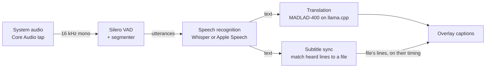

# Subtitler docs

Subtitler turns the sound your Mac plays into subtitles, translated if you like, fully on
device. These docs explain every part of it, both **how the app does it** and **the AI
and audio ideas underneath**, so they double as a course in practical AI engineering:
speech models, translation models, running models on a laptop, and the systems work
(latency, streaming, measurement) that makes them usable.

Each feature has its own page. Every page follows the same pattern:

- **Concepts**: the ideas you need, from first principles.
- **How Subtitler does it**: the design, with the numbers that shaped it.
- **Try it**: commands you can run to see it for yourself.
- **Code map**: where it lives.
- **Further reading**.

## The big picture

| Stage | Model / technology | Runs on |
|---|---|---|
| Capture | Core Audio process tap | audio thread |
| Voice activity | Silero VAD (neural, 2 MB) via ONNX Runtime | CPU |
| Speech → text | Whisper Large v3 Turbo via WhisperKit (CoreML), or Apple Speech | Neural Engine / GPU |
| Translation | MADLAD-400 3B (encoder–decoder), 4-bit GGUF via llama.cpp | GPU (Metal) |
| Subtitle sync | Fuzzy text matching (character-bigram Dice) + a clock | CPU |

## Reading order

Start at the top; each page builds on the ones before it.

1. [Architecture](01-architecture.md): the app's parts, sessions, threads and actors.
2. [Audio capture](02-audio-capture.md): getting the Mac's sound, as 16 kHz mono.
3. [Voice activity detection](03-voice-activity-detection.md): when is someone speaking?
4. [Speech recognition](04-speech-recognition.md): Whisper and Apple Speech.
5. [The live pipeline and latency](05-live-pipeline-and-latency.md): making it fast.
6. [Translation](06-translation.md): neural machine translation on a laptop.
7. [Language detection and confidence](07-language-detection-and-confidence.md).
8. [Captions and the overlay](08-captions-and-overlay.md).
9. [Subtitle sync](09-subtitle-sync.md): following a subtitle file along with the video.
10. [Subtitle files and OpenSubtitles](10-subtitle-files-and-opensubtitles.md).
11. [Models and downloads](11-models-and-downloads.md).
12. [Build, test and debug](12-build-test-debug.md).
13. [Lessons and next steps](13-lessons-and-next-steps.md): what went wrong, what's next.
14. [Cloud translation](14-cloud-translation.md): LLM translation with your own key, prompting, batching, and keeping keys safe.

## Glossary

| Term | Meaning |
|---|---|
| **ASR** | Automatic speech recognition: audio in, text out. |
| **MT / NMT** | (Neural) machine translation. |
| **VAD** | Voice activity detection: is this bit of audio speech? |
| **Utterance** | One stretch of speech between pauses. |
| **Draft / final** | Text for an utterance still in progress / a finished one. |
| **Encoder–decoder** | A model that first reads the whole input (encoder), then writes the output one token at a time (decoder). Whisper and MADLAD are both this shape. |
| **Token** | The unit models read and write: a word piece, character or byte sequence. |
| **Quantization** | Storing model weights in fewer bits (e.g. 4 instead of 16) to save memory and bandwidth. |
| **GGUF** | The llama.cpp file format for (usually quantized) models. |
| **CoreML / ANE** | Apple's model runtime / the Neural Engine chip it can run on. |
| **Latency** | Here: time from when someone stops talking to the caption appearing. |
| **Cue** | One timed line in a subtitle file. |
